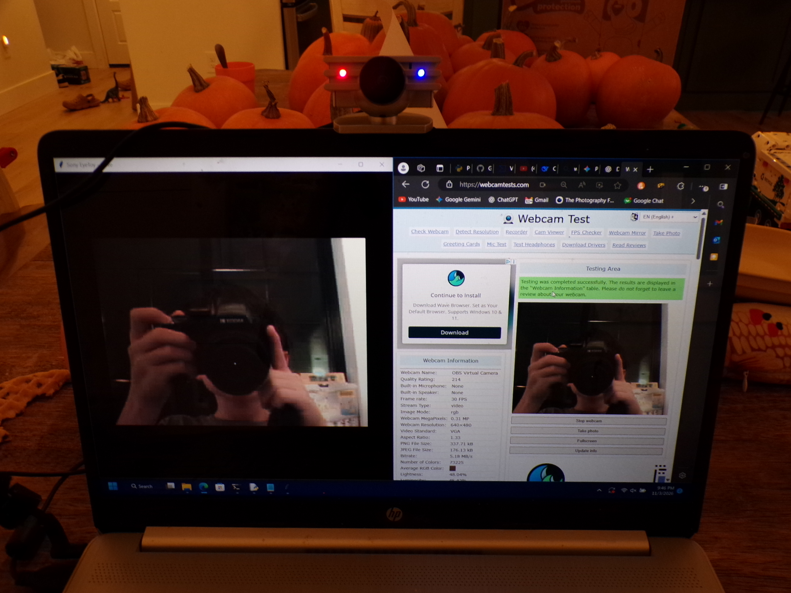

# EyeToy2Windows

Turns a PS2 EyeToy (VID 054C / PID 0155) into a standard webcam that works with Discord, Zoom, OBS, etc.

This is a pure Python solution using WinUSB. No custom kernel drivers required.

## Photos
Images:



From EyeToy:


## Usage

1. Double-click `EyeToy2Windows v0.2.0.exe` (if you got it from the release. if not open 'EyeToy2Windows v0.2.0.py').
2. A terminal and a preview window will open.

**You can close the preview window or unplug the camera to stop the stream.**

## Setup Virtual Cameras (For use as a webcam)

**1. Get the Virtual Camera working**

Windows needs OBS to create a Virtual Camera.

- Install [OBS Studio](https://obsproject.com/).
- Open it once, click **Start Virtual Camera** in the bottom right, then click **Stop Virtual Camera**.
- You can close OBS now.

**2. Unlock virtual cameras in Windows 11**

Windows 11 blocks virtual cameras by default (in most cases use this but you might not have to).

- Open Command Prompt as Administrator.
- Run this:

```cmd
reg add "HKLM\SOFTWARE\Microsoft\Windows Media Foundation\Platform" /v EnableFrameServerMode /t REG_DWORD /d 1 /f
```

**3. To use in video call etc.**

Open your app and change the source to "OBS Virtual Camera" and for audio use source "EyeToy USB camera Namtai".

## Antivirus Warning

Windows Defender or Chrome might flag the `.exe` as suspicious. This can happen because of PyInstaller packaging Python into a single file.

If it gets blocked, investigate the detection and verify the executable's source before deciding whether to allow it.
